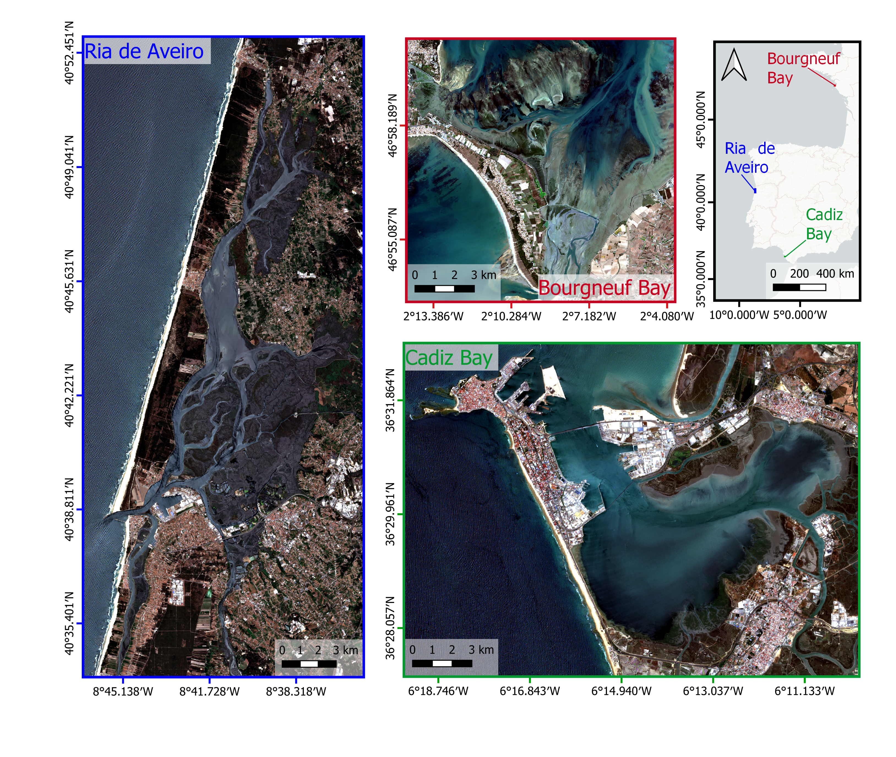
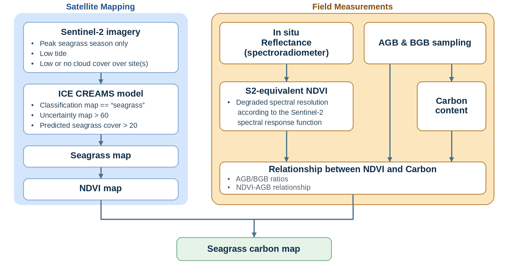
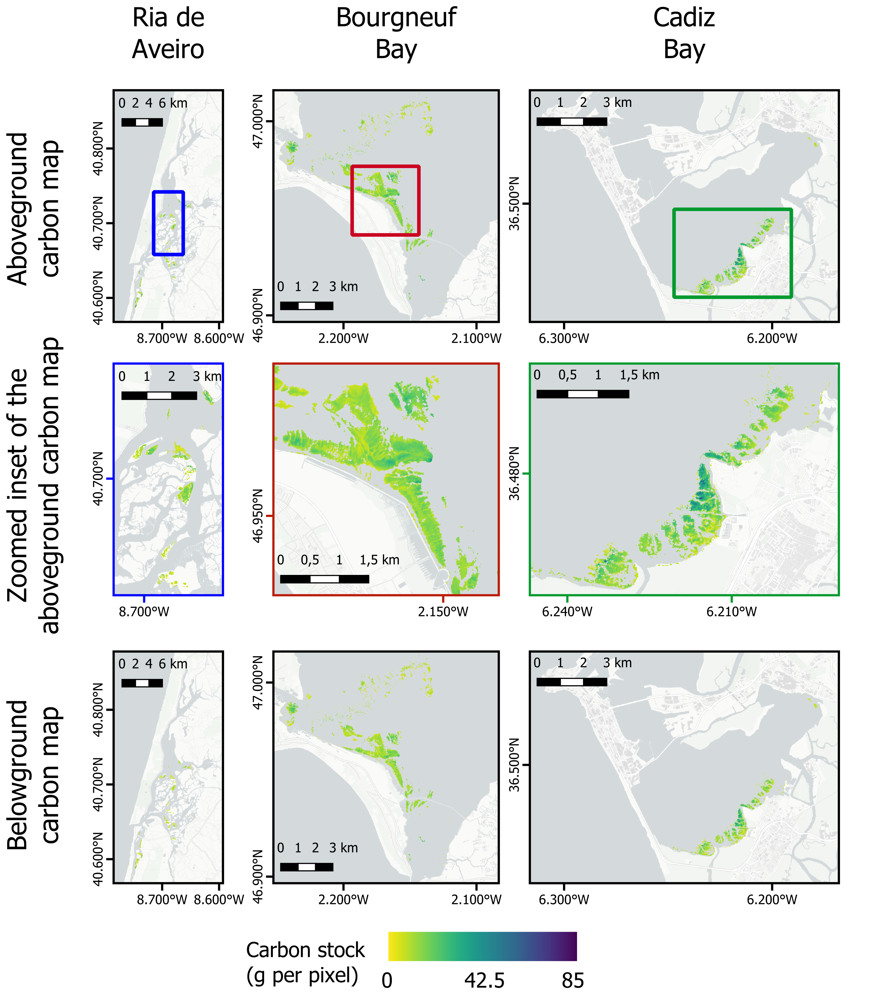

```{r setup, include=FALSE}
knitr::opts_chunk$set(echo = TRUE)

library(magrittr)
library(readxl)
library(dplyr)
library(tidyr)
library(signal)
library(stringr)
library(ggplot2)
library(geomtextpath)
library(patchwork)
library(terra)
library(ggpubr)
# library(ggiraph)
# library(stringr)
# library(ggtext)
# library(see)
```

This is a work in progress document for an upcoming publication.

## Introduction

Work in progress

## Methods and Materials

### Study sites

```{r studysites}
#| echo: false
#| error: false
#| message: false
#| warning: false
#| fig.align: 'center'
#| fig.cap: 'Overview map of the three study sites. Basemap: CartoDB Light No Labels.'


```
#### Bourgneuf Bay

Bourgneuf Bay is located southeast of the Loire Estuary. It is enclosed by Noirmoutier island in the southwest and has a mouth spanning 12 km in the northwest. The bay has a semidiurnal tidal regime and a tidal height of 2 to 6 m. It spans 340 km2 in surface area, of which 100 km² is intertidal area consisting mudflats and rocky areas [@barille2020]. 

Both _Zostera noltii_ and _Zostera marina_ are found in this site. The seagrass meadows have a predicted seagrass extent of 4.9 km² in September 2021 [@davies2024a]. Seasonally, the peak meadow expansion rate occurs in July and their maximum extent is reached in September [@davies2024b]. In April, the seagrass meadows decrease to an annual minimum of almost 0 km². 


#### Cadiz Bay

Owing to historical development in the area, Cadiz Bay comprises two basins that are connected by a narrow channel. The outer basin has an area of 70 km² and is connected to the ocean in the west. The inner basin has an area of more than 50 km², including large areas of marshes in its intertidal zone. Ninety seven percent of its intertidal zone has a muddy bottom. The Puntales channel connects both basins, and is 3.8 km long and 1.3 km wide. The tidal regime is mainly semidiurnal, with a tidal range of 1 to 4 m [@zarzuelo2017].  

_Z. noltii_, _Z. marina_, and _Cymodocea nodosa_ are found in this site. The seagrass meadows have a predicted seagrass extent of 2.1 km² in November 2021 [@davies2024a]. Seasonally, the peak meadow expansion rate occurs in August and their maximum extent is reached in October [@davies2024b]. Between June to July, the seagrass meadows decrease to an annual minimum.


#### Ria de Aveiro

Ria de Aveiro is a shallow coastal lagoon that is largely shaped by human related development, including various construction works and dredging. The lagoon is about 45 km long and 8.5 km wide and connected to the sea via an artificial inlet. It has a semidiurnal tidal regime, with a tidal range of 0.6 to 3.2 m. The lagoon contains large mudflats, salt marshes, and narrow channels [@dias2021]. 

Both _Z. noltii_ and _Z. marina_ are found in this site. The seagrass meadows have a predicted seagrass extent of 3.5 km² in December 2017 [@davies2024a]. Seasonally, the peak meadow expansion rate occurs in September and their maximum extent is reached in November [@davies2024b]. In June, the seagrass meadows decrease to an annual minimum.


```{r workflow}
#| echo: false
#| error: false
#| message: false
#| warning: false
#| fig.align: 'center'
#| fig.cap: 'Study workflow.'


```

### Field sampling and processing

```{r importSpectra}
#| echo: false
#| error: false
#| message: false
#| warning: false

srf <- read_xlsx('data/COPE-GSEG-EOPG-TN-15-0007 - Sentinel-2 Spectral Response Functions 2022 - 3.2.xlsx', sheet = 'Spectral Responses (S2A)') %>% 
  dplyr::filter(SR_WL >= 400, SR_WL <= 900)

reflectance.BB.2018 <- read.table('data/spectra/BB/2018_09_Bourgneuf_reflectance-cores_raw.txt', header = TRUE) %>%
  pivot_longer(cols = names(.)[-1], names_to = "id", values_to = 'raw.value') %>%
  rename(Wavelength = wavelength) %>%
  mutate(id = paste(str_split_i(id, pattern = "_", 1) , str_split_i(id, pattern = "_", 2), sep = '_') %>% paste('2018', sep = '.')) %>%
  group_by(id) %>%
  mutate(raw.value = sgolayfilt(raw.value, 3, 11), .keep = 'all') %>%
  dplyr::filter(Wavelength >= 400, Wavelength <= 900) %>%
  ungroup()

reflectance.BB.2025 <- read.csv('data/spectra/BB/20250911_Bourgneuf_H_stations_reflectance.txt', sep = '\t') %>%
  pivot_longer(cols = names(.) %>% grep('Wavelength', ., invert = TRUE, value = TRUE), names_to = "ASD", values_to = 'value') %>%
  mutate(id = str_split_i(ASD, pattern = '\\.', 1) %>% gsub('H', 'H_', .)) %>%
  select(-ASD) %>%
  group_by(Wavelength,id) %>%
  summarise(raw.value = mean(value, na.rm = TRUE)) %>%
  ungroup() %>%
  group_by(id) %>%
  mutate(raw.value = sgolayfilt(raw.value, 3, 11), .keep = 'all') %>%
  dplyr::filter(Wavelength >= 400, Wavelength <= 900) %>%
  ungroup()

reflectance.AV.2025 <- list.files('data/spectra/AV', full.names = TRUE) %>%
  grep('\\.txt', ., value = TRUE) %>%
  lapply(FUN = function(f) {
    g <- read.csv(f, sep = '\t')
    h <- names(g)[2] %>% 
      gsub('\\.asd', "", .)
      names(g)[2] <- "reading"
      g$Name <- h
    
    return(g)
  }) %>%
  do.call(rbind, .) %>%
  mutate(dataset = str_split_i(Name, pattern = '00', 1), rep = str_split_i(Name, pattern = '00', -1) %>% as.numeric() %>% add(1),
         id = case_when(
  # NG group
  dataset == 'AVEI2' & rep >= 341 & rep <= 360 ~ "NG12",
  dataset == 'AVEI2' & rep >= 401 & rep <= 420 ~ "NG15",
  dataset == 'AVEI2' & rep >= 381 & rep <= 400 ~ "NG16",
  dataset == 'AVEI2' & rep >= 301 & rep <= 320 ~ "NG18",
  dataset == 'AVEI2' & rep >= 281 & rep <= 300 ~ "NG25",
  dataset == 'AVEI2' & rep >= 261 & rep <= 280 ~ "NG30",
  dataset == 'AVEI2' & rep >= 221 & rep <= 240 ~ "NG31",
  dataset == 'AVEI2' & rep >= 201 & rep <= 220 ~ "NG32",
  dataset == 'AVEI2' & rep >= 361 & rep <= 380 ~ "NR43", 
  dataset == 'AVEI2' & rep >= 321 & rep <= 340 ~ "NR44", 
  dataset == 'AVEI2' & rep >= 241 & rep <= 260 ~ "NR52", 

  # RR/RG group
  dataset == 'AVE' & rep >= 1 & rep <= 20 ~ "RG12",
  dataset == 'AVE' & rep >= 21 & rep <= 40 ~ "RR36",
  dataset == 'AVE' & rep >= 41 & rep <= 60 ~ "RG5", 
  dataset == 'A' & rep >= 1 & rep <= 20 ~ "RG13",
  dataset == 'A' & rep >= 21 & rep <= 40 ~ "RG6", 
  dataset == 'A' & rep >= 41 & rep <= 60 ~ "RG7", 
  dataset == 'A' & rep >= 61 & rep <= 80 ~ "RG8", 
  dataset == 'A' & rep >= 101 & rep <= 120 ~ "RR46",
  dataset == 'A' & rep >= 121 & rep <= 140 ~ "RG16",
  dataset == 'A' & rep >= 141 & rep <= 160 ~ "RG23",
  dataset == 'A' & rep >= 161 & rep <= 180 ~ "RR45",
  dataset == 'A' & rep >= 181 & rep <= 200 ~ "RG22"
)) %>%
  # average the readings 
  dplyr::filter(!is.na(id)) %>%
  group_by(id, Wavelength) %>%
  select(-c(rep, Name)) %>%
  summarise(raw.value = mean(reading), dataset = unique(dataset)) %>%
  ungroup() %>%
  group_by(id) %>%
  mutate(raw.value = sgolayfilt(raw.value, 3, 11), .keep = 'all') %>%
  dplyr::filter(Wavelength >= 400 & Wavelength <= 900) %>%
  ungroup() %>%
  select(-dataset)

reflectance.CB.2025 <- local({
  reflectance <- read.csv('data/spectra/CB/20250610_rw_cadiz_seagrass.txt', sep = '\t') %>%
    pivot_longer(cols = names(.) %>% grep('Wavelength', ., invert = TRUE, value = TRUE), names_to = "ASD", values_to = 'value') %>%
    mutate(group = unlist(substr(ASD, 1, 4)), rep = as.numeric(unlist(substr(ASD, 7, 10))))
  
  readMe <- read.csv('data/spectra/CB/20250610_rw_cadiz_seagrass_readme.txt', sep = ',') %>%
    mutate(group = substr(Spectrum_id_start, 1, 4), 
           id_start = as.numeric(unlist(substr(Spectrum_id_start, 7, 10))), id_end = as.numeric(unlist(substr(Spectrum_id_end, 7, 10)))
           )
    
    reflectance$id <- reflectance %>% 
      apply(MARGIN = 1, FUN = function(row) {
        output <- readMe$Station[readMe$group == row['group'] & readMe$id_start <= as.numeric(row['rep']) & readMe$id_end >= as.numeric(row['rep'])]
        ifelse(is.null(output), NA, output)
      }) %>% 
      unlist()
  
  reflectance <- reflectance %>%
    select(-ASD) %>%
    dplyr::filter(!is.na(id)) %>%
    group_by(Wavelength,id) %>%
    summarise(raw.value = mean(value, na.rm = TRUE)) %>%
    ungroup() %>%
    group_by(id) %>%
    mutate(raw.value = sgolayfilt(raw.value, 3, 11), .keep = 'all') %>%
    dplyr::filter(Wavelength >= 400, Wavelength <= 900) %>%
    ungroup()
  
  reflectance 
}) 
```

```{r importBiomassCarbon}
#| echo: false
#| error: false
#| message: false
#| warning: false

convert_biomass_to_per_m2 <- function(biomass) {
  core_area <- pi*((15/2)^2)
  biomass_per_m2 <- biomass*(100^2/core_area)
  
  return(biomass_per_m2)
}

biomass.BB.2018 <- read.csv('data/biomass_carbon/2018_09_Bourgneuf_cores_biomass_percent_cover.csv', sep = '\t') %>%
  mutate(A_per_m2 = convert_biomass_to_per_m2(Leaf_dry_weight_g),
         B_per_m2 = NA,
         site = 'BB', year = '2018',
         ID = paste(Sample_ID, year, sep = ".") %>% gsub('_61', '', .),
         Group = paste(site, year, sep = "_"),
         TOC_A = NA, TOC_B = NA) %>%
  select(-c(Percent_cover, Sample_ID, `Leaf_dry_weight_g`)) %>%
  dplyr::filter(!is.na(A_per_m2))

biomass.BB.2019 <- read_xlsx('data/biomass_carbon/Data AGB BGB Bourgneuf 2019.xlsx') %>%
  rename(ID = Sample_ID, A_per_m2 = `Leaf biomass (g DW m-2)`, B_per_m2 = `Rizhome biomass  (g DW m-2)`) %>%
  mutate(site = 'BB', year = 2019, Group = paste(site, year, sep = "_"),
         TOC_A = NA, TOC_B = NA, ndvi = NDVI) %>%
  select(-c(`Seagrass coverage (%)`, NDVI)) 

biomass.BB.2025 <- read_xlsx('data/biomass_carbon/Bourgneuf2025_Biomass_C_cores.xlsx') %>%
  mutate(Label = str_split_i(Label, pattern = "_", -1)) %>%
  select(-c(PartType, Habitat)) %>%
  pivot_wider(names_from = Label, 
              values_from = c(DryMassTotal, DryMassTC, CarbonTC, DryMassIC, CarbonIC)) %>%
  mutate(A_per_m2 = convert_biomass_to_per_m2(as.numeric(DryMassTotal_A)/1000),
         B_per_m2 = convert_biomass_to_per_m2(as.numeric(DryMassTotal_B)/1000),
         TOC_A = (as.numeric(CarbonTC_A)/1000)/(as.numeric(DryMassTC_A)/1000) - (as.numeric(CarbonIC_A)/1000)/(as.numeric(DryMassIC_A)/1000),
         TOC_B = (as.numeric(CarbonTC_B)/1000)/(as.numeric(DryMassTC_B)/1000) - (as.numeric(CarbonIC_B)/1000)/(as.numeric(DryMassIC_B)/1000),
         site = 'BB', year = 2025) %>%
  select(-c(DryMassTotal_A,DryMassTotal_B,DryMassTC_A,DryMassTC_B,CarbonTC_A,CarbonTC_B,DryMassIC_A,DryMassIC_B,CarbonIC_A,CarbonIC_B,CoreType))

biomass.AV.2025 <- read_xlsx('data/biomass_carbon/Aveiro2025_Biomass_C_cores.xlsx', sheet = 'data') %>%
  mutate(Label = str_split_i(Label, pattern = "_", -1),
         DryMassTotal = as.numeric(DryMassTotal),
         DryMassTotal = case_when(Habitat == 'seagrass' ~ DryMassTotal, 
                                  Habitat != 'seagrass' & !is.na(DryMassTotal) ~ 0)) %>%
  select(-c(PartType, Habitat)) %>%
  pivot_wider(names_from = Label, 
              values_from = c(DryMassTotal, DryMassTC, CarbonTC, DryMassIC, CarbonIC)) %>%
  mutate(A_per_m2 = case_when(DryMassTotal_B > 0 ~ convert_biomass_to_per_m2(as.numeric(DryMassTotal_A)/1000),
                              DryMassTotal_B == 0 ~ 0), # if there's no root biomass, the leaf biomass are not growing at this station
         B_per_m2 = convert_biomass_to_per_m2(as.numeric(DryMassTotal_B)/1000),
         TOC_A = (as.numeric(CarbonTC_A)/1000)/(as.numeric(DryMassTC_A)/1000) - (as.numeric(CarbonIC_A)/1000)/(as.numeric(DryMassIC_A)/1000),
         TOC_B = (as.numeric(CarbonTC_B)/1000)/(as.numeric(DryMassTC_B)/1000) - (as.numeric(CarbonIC_B)/1000)/(as.numeric(DryMassIC_B)/1000),
         site = 'AV', year = 2025, ID = gsub(' ', '', ID)) %>%
  select(-c(DryMassTotal_A,DryMassTotal_B,DryMassTC_A,DryMassTC_B,CarbonTC_A,CarbonTC_B,DryMassIC_A,DryMassIC_B,CarbonIC_A,CarbonIC_B,CoreType))

biomass.CB.2025 <- read_xlsx('data/biomass_carbon/Cadiz2025_Biomass_C_cores.xlsx', sheet = 'data') %>%
         # fix bare points with a non-zero seagrass biomass despite being bare (zero)
  mutate(DryMassTotal = case_when(Habitat == 'bare' ~ 0,
                                  .default = as.numeric(as.character(DryMassTotal))),
         PartType = case_when(PartType == 'Leaves' ~ 'A', 
                              PartType == 'Roots' ~ 'B')) %>%
  select(-c(Label, Habitat)) %>%
  pivot_wider(names_from = PartType, 
              values_from = c(DryMassTotal, DryMassTC, CarbonTC, DryMassIC, CarbonIC)) %>%
  mutate(A_per_m2 = convert_biomass_to_per_m2(as.numeric(DryMassTotal_A)/1000),
         B_per_m2 = convert_biomass_to_per_m2(as.numeric(DryMassTotal_B)/1000),
         TOC_A = (as.numeric(CarbonTC_A)/1000)/(as.numeric(DryMassTC_A)/1000) - (as.numeric(CarbonIC_A)/1000)/(as.numeric(DryMassIC_A)/1000),
         TOC_B = (as.numeric(CarbonTC_B)/1000)/(as.numeric(DryMassTC_B)/1000) - (as.numeric(CarbonIC_B)/1000)/(as.numeric(DryMassIC_B)/1000),
         site = 'CB', year = 2025, ID = paste0('ST',gsub(' ', '', ID))) %>%
  select(-c(DryMassTotal_A,DryMassTotal_B,DryMassTC_A,DryMassTC_B,CarbonTC_A,CarbonTC_B,DryMassIC_A,DryMassIC_B,CarbonIC_A,CarbonIC_B,CoreType)) %>%
  dplyr::filter(A_per_m2 < 600) # check value
```

```{r CombiningReflectanceBiomassCarbon}
#| echo: false
#| error: false
#| message: false
#| warning: false

combine_biomass_reflectance <- function(biomass, reflectance) {
  r <- reflectance %>%
    group_by(id) %>%
    summarise(red = weighted.mean(raw.value, srf$S2A_SR_AV_B4), nir = weighted.mean(raw.value, srf$S2A_SR_AV_B8), ndvi = (nir - red)/(nir + red)) %>%
    select(id, ndvi)
  output <- biomass %>%
    full_join(r, by = join_by(ID == id))
  
  return(output)
}

BB.2018 <- combine_biomass_reflectance(biomass.BB.2018, reflectance.BB.2018) %>%
  dplyr::filter(!is.na(A_per_m2), !is.na(ndvi))

BB.2019 <- biomass.BB.2019 %>%
  mutate(ID = paste(ID, '2019', sep = '.')) %>% 
  dplyr::filter(!is.na(A_per_m2))

BB.2025 <- combine_biomass_reflectance(biomass.BB.2025, reflectance.BB.2025) %>%
  dplyr::filter(!is.na(A_per_m2), !is.na(B_per_m2))

AV.2025 <- combine_biomass_reflectance(biomass.AV.2025, reflectance.AV.2025) %>%
  dplyr::filter(!is.na(A_per_m2))

CB.2025 <- combine_biomass_reflectance(biomass.CB.2025, reflectance.CB.2025) %>%
  dplyr::filter(!is.na(A_per_m2)) 

df <- rbind(BB.2018, BB.2019, BB.2025, AV.2025, CB.2025)

## TOC is the total organic carbon content. Need to convert it to the total organic carbon stock
mean_TOC <- df %>%
  select(TOC_A, TOC_B, year, site) %>%
  group_by(year, site) %>%
  summarise(mean_TOC_A = mean(TOC_A, na.rm = TRUE), mean_TOC_B = mean(TOC_B, na.rm = TRUE)) %>%
  ungroup() %>%
  select(-year) %>%
  dplyr::filter(!is.na(mean_TOC_A))

df <- df %>%
  left_join(mean_TOC, join_by(site == site)) %>%
  mutate(mean_TOC_A = case_when(year != 2025 ~ NA_real_,
                                year == 2025 ~ mean_TOC_A,
                                is.nan(mean_TOC_A) ~ NA_real_),
         mean_TOC_B = case_when(year != 2025 ~ NA_real_,
                                year == 2025 ~ mean_TOC_B,
                                is.nan(mean_TOC_B) ~ NA_real_),
         Carbon_stock_A = A_per_m2 * mean_TOC_A,
         Carbon_stock_B = B_per_m2 * mean_TOC_B
         )
```


```{r removeanomalousdata}
#| echo: false
#| error: false
#| message: false
#| warning: false

df <- df %>%
  dplyr::filter(!ID %in% c("NR43", "RG5", "RG12", "RG13", "NR52", "NR44", "ST02", "ST03", "ST05"))
```
The fieldwork was conducted at all three sites as shown in Table 1. Other than the fieldwork done in 2025, additional field data for Bourgneuf Bay conducted in 2018 and 2019 were also included to the dataset.

<!-- ```{r tableNoOfData} -->
<!-- # #| echo: false -->
<!-- # #| error: false -->
<!-- # #| message: false -->
<!-- # #| warning: false -->
<!-- #  -->
<!-- # count_valid <- function(vector) { -->
<!-- #   return(sum(!is.na(vector))) -->
<!-- # } -->
<!-- #  -->
<!-- # table.data <- data.frame( -->
<!-- #   list( -->
<!-- #     "Site" = c('Bourgneuf Bay', 'Bourgneuf Bay', 'Bourgneuf Bay', 'Ria de Aveiro', 'Cadiz Bay', 'Total'), -->
<!-- #      -->
<!-- #     "Year" = c(2018, 2019, 2025, 2025, 2025, ''), -->
<!-- #      -->
<!-- #     "Radiometry" = c(count_valid(BB.2018$ndvi), count_valid(BB.2019$ndvi), count_valid(BB.2025$ndvi), count_valid(AV.2025$ndvi), count_valid(CB.2025$ndvi),  -->
<!-- #                      sum(c(count_valid(BB.2018$ndvi), count_valid(BB.2019$ndvi), count_valid(BB.2025$ndvi), count_valid(AV.2025$ndvi), count_valid(CB.2025$ndvi)))), -->
<!-- #      -->
<!-- #     "Aboveground biomass" = c(count_valid(BB.2018$A_per_m2), count_valid(BB.2019$A_per_m2), count_valid(BB.2025$A_per_m2), count_valid(AV.2025$A_per_m2), count_valid(CB.2025$A_per_m2),  -->
<!-- #                               sum(c(count_valid(BB.2018$A_per_m2), count_valid(BB.2019$A_per_m2), count_valid(BB.2025$A_per_m2), count_valid(AV.2025$A_per_m2), count_valid(CB.2025$A_per_m2)))), -->
<!-- #      -->
<!-- #     "Belowground biomass" = c(count_valid(BB.2018$B_per_m2), count_valid(BB.2019$B_per_m2), count_valid(BB.2025$B_per_m2), count_valid(AV.2025$B_per_m2), count_valid(CB.2025$B_per_m2),  -->
<!-- #                               sum(c(count_valid(BB.2018$B_per_m2), count_valid(BB.2019$B_per_m2), count_valid(BB.2025$B_per_m2), count_valid(AV.2025$B_per_m2), count_valid(CB.2025$B_per_m2)))),  -->
<!-- #      -->
<!-- #     "Aboveground carbon" = c(count_valid(BB.2018$TOC_A), count_valid(BB.2019$TOC_A), count_valid(BB.2025$TOC_A), count_valid(AV.2025$TOC_A), count_valid(CB.2025$TOC_A),  -->
<!-- #                              sum(c(count_valid(BB.2018$TOC_A), count_valid(BB.2019$TOC_A), count_valid(BB.2025$TOC_A), count_valid(AV.2025$TOC_A), count_valid(CB.2025$TOC_A)))), -->
<!-- #      -->
<!-- #     "Belowground carbon" = c(count_valid(BB.2018$TOC_B), count_valid(BB.2019$TOC_B), count_valid(BB.2025$TOC_B), count_valid(AV.2025$TOC_B), count_valid(CB.2025$TOC_B),  -->
<!-- #                              sum(c(count_valid(BB.2018$TOC_B), count_valid(BB.2019$TOC_B), count_valid(BB.2025$TOC_B), count_valid(AV.2025$TOC_B), count_valid(CB.2025$TOC_B)))), -->
<!-- #      -->
<!-- #     "Source" = c('@zoffoli2020', '@zoffoli2020', 'Current study', 'Current study', 'Current study', '') -->
<!-- #   ) -->
<!-- # ) -->
<!-- #  -->
<!-- # names(table.data) <- c('Site', 'Year', 'Radiometry', 'Aboveground biomass', 'Belowground biomass', 'Aboveground carbon', 'Belowground carbon', 'Source') -->
<!-- #  -->
<!-- # knitr::kable(table.data,  -->
<!-- #              format = "pipe", -->
<!-- #              align = 'c', -->
<!-- #              caption = 'Available data across the different field campaign.') -->
<!-- ``` -->

For every station, seagrass cover was visually assessed with the aid of a 50 cm by 50 cm quadrat. The location of each station was measured using an Emlid Reach RS2+ GNSS receiver with RTK corrections.

#### Seagrass biomass

Sediment cores were collected using a 15 cm diameter length PVC pipe. The coring was sufficiently deep, such that all belowground biomass were collected.

The collected samples were rinsed in seawater and sieved using a 40 cm diameter stainless steel sieve with a mesh size of 1 mm to remove as much substrate as possible. The samples were then transported to back to the laboratory and preserved in a fridge.

The samples were sorted into leaf and root matter by separating the plant at the internode.

The samples were dried in an oven at 60 °C for 48 hours. After desiccation, the samples were weighed using a bench scale to obtain their dry weight.

#### Seagrass carbon

The dried samples were placed in 50 ml falcon tubes with a ceramic ball of diameter 20 mm. The tubes were loaded onto the Mixer Mill MM 400 and grinded at 30 Hz at 30 seconds. If the initial grinding was insufficient, the sample was grinded again at the same intensity and period until homogeneous. 

The measurement of total carbon (TC) and inorganic carbon (IC) content in fly ash were performed using a SSM-5000A Shimadzu Solid Sample Combusion Unit attached to a Shimadzu Total Organic Carbon Analyzer L-Series (TOC-L), with its proprietary software for immediate data logging (Figure 1.1).

To measure the TC content in a sample, about 70g of powdered biomass was combusted at 900 °C for 8 minutes. For the IC content measurement, between 200-800 g of powdered biomass was mixed with 0.9 ml of phosphorous acid (HPO3) and combusted at 300 °C until no carbon dioxide is detected. The increased weight of sample used was to increase the IC content measurement, as about 200 g of sample produced around 2 mg of carbon while 700 g of sample yielded around 6 mg of carbon. The measurements were scaled to the unit weight of the samples based on the sample dry weight used for the measurement (Equation \@ref(eq:carbon)).

\begin{equation}
\text{Carbon content (g per C/g)} = \frac{\text{Measured carbon (g)}}{\text{Sample dry weight (g)}} (\#eq:carbon)
\end{equation}

A subset of the samples were used to test for possible water content in the sample. These samples were placed in a 105 &deg;C oven and measured after 2 hours and 3 hours. Any difference in weight was attributed to water content loss (Equation \@ref(eq:correctedDW)). Since only a subset was used in this test, the results were averaged and used to correct for the sample dry weight in Equation \@ref(eq:carbon).

\begin{equation}
\text{Corrected dry weight} = \frac{\text{Pre-oven dry weight}}{\text{Post-oven dry weight}} \times \text{Subsampled dry weight} (\#eq:correctedDW)
\end{equation}

The [difference between the TC and IC content is the total organic carbon content (TOC)](https://www.shimadzu.com/an/apl/24168/index.html) (Equation \@ref(eq:toc)). The TOC is the mass of organic carbon in a unit mass of a dry weight sample.

\begin{equation}
\text{TOC (g C/g)} = \text{TC} - \text{TIC} (\#eq:toc)
\end{equation}

#### Radiometric measurements

For select stations, in situ spectroradiometric measurements were measured using an ASD FieldSpec HandHeld 2. The ASD was calibrated using a white reference panel before each measurement to account for possible ambient light changes and instrumental noise. Twenty readings were measured per station and averaged to obtain an averaged spectrum. The averaged hyperspectral signature was smoothed with a Savitzky-Golay filter using the sgolayfilt() function [@signal2023] at third order and length of 11. While this means that the first and last five wavelengths would be dropped, given the spectroradiometer’s full wavelength range of 325 nm to 1075 nm and the final working range of 400 nm to 900 nm, these affected wavelengths will be filtered out anyway and thus irrelevant here.


```{r imagefieldwork}
#| echo: false
#| error: false
#| message: false
#| warning: false
#| out.width: "99%"
#| fig.align: 'center'
#| fig.show: 'hold'
#| fig.cap: 'Spectroradiometric measurements of seagrasses at Cadiz Bay (A). After these measurements were taken, the measured seagrass area was then extracted with a 15 cm diameter PVC pipe (B). This ensures that the collected seagrass biomass and their corresponding seagrass cover is directly related to the aforementioned measurements (C). The samples were then cleaned and sorted into aboveground biomass containing leaves (D) and belowground biomass containing roots and rhizomes (E).'

# knitr::include_graphics(c('image/field_spectroradiometric_measurement.jpg','image/field_sampling.jpg',
#                           'image/field_coreprint.jpg','image/lab_agb.jpg',
#                           'image/lab_bgb.jpg'
#                           ))
knitr::include_graphics('image/Combined_image_M&M_V2.png')
```

Post-smoothing, only the wavelengths from 400 nm to 900 nm were retained and a min-max standardisation was performed.

For comparison with the Sentinel 2 imagery, the wavelengths were degraded to the Sentinel 2 bands based on the spectral response function of Sentinel 2A provided in “COPE-GSEG-EOPG-TN-15-0007 - Sentinel-2 Spectral Response Functions 2022 - 3.2” [@esa2023]. From the degraded bands, the Normalised Difference Vegetation Index (NDVI) was derived using Equation \@ref(eq:ndvi):

\begin{equation}
\text{NDVI} = \frac{R(\lambda_{\text{NIR}}) - R(\lambda_{\text{Red}})}{R(\lambda_{\text{NIR}}) + R(\lambda_{\text{Red}})} (\#eq:ndvi)
\end{equation}


#### Establishing relationships between reflectance, biomass and carbon

The relationships between the spectroradiometer reflectance and aboveground biomass were first investigated to develop an algorithm to predict aboveground biomass from reflectance. Next, the site-specific ratio between the aboveground and belowground biomass were derived to predict belowground biomass from aboveground biomass. Finally, the site-specific carbon content for both the above- and belowground biomass was investigated in order to predict carbon stock from the relevant biomass data.


#### Satellite data and processing

Low tide Sentinel-2 Level-2A Surface reflectance _R(λ)_ images with few clouds or cloud shadows over the study sites were identified and downloaded. 

The images were then processed with the two step ICE CREAMS model approach. Firstly, an intertidal mask to produce an intertidal classification map, a seagrass cover map and a classification uncertainty map. Pixels that do not fulfil all three conditions were masked:

1.	Classified as seagrass in the ICE CREAMS classification map
2.	Have a classification certainty of at least 60 %
3.	Have a seagrass percent cover of at least 20%

Next, the seagrass cumulative extent was calculated by summing the masked seagrass cover map. Since each pixel of the ICE CREAMS output maps is 100 m2, therefore each unit in percent cover of the pixel would directly translate into a unit area of the seagrass extent in square metres [@davies2024b]. 
Since the current version of ICE CREAMS no longer provides an NDVI map as a default output, an NDVI image was derived from the masked Sentinel 2 Level 2A _R(λ)_ images using Equation \@ref(eq:ndvi).


#### Predicted seagrass carbon map

The relationships established in Section 2.3. were applied to the masked Sentinel 2 Level 2A _R(λ)_ images to predict and map the above- and belowground seagrass biomass and their corresponding carbon content. By multiplying the seagrass biomass map with the relationship between seagrass biomass and carbon content, the seagrass carbon stock map can be obtained. These biomass and carbon stock maps were then separately summed to obtain the total seagrass biomass and total seagrass carbon stock in each site.


#### Validation and error propagation

WIP.

## Results

```{r plotNDVIincreasingbiomass}
#| echo: false
#| error: false
#| message: false
#| warning: false
#| fig.cap: 'Min-max standardised values of spectroradiometer measurements to the leaf dry weight.'

combine_biomass_reflectance_2 <- function(biomass, reflectance) {
  minmax <- reflectance %>%
    group_by(id) %>%
    mutate(std.value = (raw.value - min(raw.value))/(max(raw.value) - min(raw.value)), .keep = "all") %>%
    ungroup()
  
  output <- biomass %>%
    full_join(minmax, by = join_by(ID == id)) %>%
    select(-c(B_per_m2, TOC_A, TOC_B, raw.value))
  
  return(output)
}

reflectance <- rbind(
  combine_biomass_reflectance_2(biomass.BB.2018, reflectance.BB.2018),
  combine_biomass_reflectance_2(biomass.BB.2025, reflectance.BB.2025),
  combine_biomass_reflectance_2(biomass.AV.2025, reflectance.AV.2025),
  combine_biomass_reflectance_2(biomass.CB.2025, reflectance.CB.2025)
)

base_size <- 14
plot_label_wavelength <- 550
theme_axis <- theme(panel.background = element_rect(fill = "transparent", colour = NA),
                    axis.line = element_line(colour = "black"),
                    axis.title = element_text(size = base_size*1.8),
                    axis.text = element_text(size = base_size*1.4),
                    legend.title = element_text(size = base_size*1.6),
                    legend.text = element_text(size = base_size*1.4),
                    legend.position = 'inside', legend.position.inside = c(1, 0.05), legend.justification = c('right','bottom'),
                    legend.background = element_rect(fill = "transparent", colour = 'black'), legend.margin = margin(t = 3, r = 5, b = 12, l = 5, unit = 'pt')
                    )

reflectance %>%
  dplyr::filter(ID %in% c("ST24", "zos_14.2018", "zos_c.2018",  "zos_e.2018", "zos_15.2018", "RR36", "zos_21.2018") %>% replace_na(TRUE)) %>% # data selection
  drop_na() %>%
  ggplot(aes(x = Wavelength, y = std.value, colour = A_per_m2, group = ID)) + 
    geom_line(linewidth = 0.7) +
    # geom_labelline(aes(label = paste(round(A_per_m2, 2), 'g/m²'), hjust = ID), linewidth = 0.7, straight = TRUE) +
    scale_colour_viridis_c(option = 'viridis', direction = -1, end = 0.95) +
    scale_hjust_discrete(range = c(0.1, 0.9)) +
    xlab('Wavelength (nm)') + ylab('Standardised\nreflectance') + labs(colour = "Dry weight\n(g/m²)") +
    theme_axis
```


```{r NDVIvsAGBcurve}
#| echo: false
#| error: false
#| message: false
#| warning: false
#| fig.cap: 'Relationship between the spectroradiometer-derived NDVI values and the seagrass aboveground biomass (AGB) (left) and the spectroradiometer-derived NDVI values and the seagrass aboveground carbon (AGC) (right).'

df.ndvi.agb <- df %>%
  select(ID, A_per_m2, ndvi, year, site) 

# base_size <- 14 # change here if previous value is no longer desired

geom_point_setting <- geom_point(shape = 21, fill = 'grey', size = 3, stroke = 1.3)

plt.ndvi_agb <- ggplot(df.ndvi.agb, aes(x = A_per_m2, y = ndvi)) +
  geom_point_setting +
  stat_function(fun = function(x) {0.67937*(1-0.84806*exp(-0.019857*x))}, colour = 'black') +
  xlab('AGB (g/m²)') + ylab('NDVI') +
  annotate('text', x = 20, y = 0.1, hjust = 0, vjust = 0, label = substitute(y == a * (1 - b*"*"*e^{c*"*"*x} ), 
           list(x = "AGB", y = "NDVI",
                a = 0.67937 %>% round(2),
                b = 0.84806 %>% round(2),
                c = 0.019857 %>% round(2)
           )) %>% 
              as.expression() %>%
              as.character(), 
          parse = TRUE, colour = 'black', size = base_size*0.3) +
  theme_axis

plt.ndvi_agc <- df %>%
  select(ID, Carbon_stock_A, ndvi, year, site, Group) %>%
  ggplot(aes(x = Carbon_stock_A, y = ndvi)) +
    stat_function(fun = function(x) {0.675 - 0.75 * exp(-0.08*x)}, colour = 'black') +
    geom_point_setting +
    xlab('AGC (g/m²)') + ylab('NDVI') +
    annotate('text', x = 0.0, y = 0.73, hjust = 0, vjust = 0, label = substitute(y == a * (1 - b*"*"*e^{c*"*"*x} ), 
             list(x = "AGC", y = "NDVI",
                  a = 0.675 %>% round(2),
                  b = 0.75 %>% round(2),
                  c = -0.08 %>% round(2)
             )) %>% 
                as.expression() %>%
                as.character(), 
            parse = TRUE, colour = 'black', size = base_size*0.3) +
    theme_axis

plt.ndvi_agb + plt.ndvi_agc
```


```{r checkndvi}
#| echo: false
#| error: false
#| message: false
#| warning: false

### test NDVI S2 vs upscaled agb (s2 pixel level) --> so that it's easier to understand the output & unit conversion
## match agb values from experiment to s2 ndvi values and plot a graph out.

```


<!-- ```{r lgAGCvsNDVI} -->
<!-- # #| echo: false -->
<!-- # #| error: false -->
<!-- # #| message: false -->
<!-- # #| warning: false -->
<!-- # #| fig.cap: 'Relationship between the seagrass aboveground carbon (AGC) and the spectroradiometer-derived NDVI values.' -->
<!-- #  -->
<!-- # relabel_eq <- function(label, r2) { -->
<!-- #   new_label <- gsub("italic\\(x\\)", "NDVI", label) %>% -->
<!-- #     gsub("italic\\(y\\)", "ln(AGC)", .) -->
<!-- #      -->
<!-- #   output <- paste("atop(", new_label, ",", r2, ")") -->
<!-- #    -->
<!-- #   return(output) -->
<!-- # } -->
<!-- #  -->
<!-- # # plt.agcNDVI.log <- df %>% -->
<!-- # #   select(ID, Carbon_stock_A, ndvi, year, site, Group) %>% -->
<!-- # #   ggplot(aes(x = ndvi, y = log(Carbon_stock_A))) + -->
<!-- # #     geom_smooth(method = 'lm', colour = 'black') + # use this only for temporary measures; best to lm() or nls() and create the uncertainty and line ourselves -->
<!-- # #     geom_point_setting + -->
<!-- # #     xlab('NDVI') + ylab('Log-transformed\nAGC (g/m²)') + -->
<!-- # #       # stat_regline_equation(label.x.npc = 'centre', label.y.npc = 'bottom', decreasing = TRUE, aes(label = paste("atop(", ..eq.label.., ",", ..adj.rr.label.., ")")), colour = 'black', size = base_size*0.4, vjust = 0, hjust = 0.5) + -->
<!-- # #     stat_regline_equation(label.x.npc = 'centre', label.y.npc = 'bottom', decreasing = TRUE, aes(label = relabel_eq(..eq.label.., ..adj.rr.label..)), colour = 'black', size = base_size*0.3, vjust = 0, hjust = 0.5) + -->
<!-- # #     theme_axis -->
<!-- #  -->
<!-- # plt.agcNDVI.curve <- df %>% -->
<!-- #   select(ID, Carbon_stock_A, ndvi, year, site, Group) %>% -->
<!-- #   ggplot(aes(x = ndvi, y = Carbon_stock_A)) + -->
<!-- #     stat_function(fun = function(x) {0.35 * exp(8.2*x)}, colour = 'black') + -->
<!-- #     # geom_smooth(method = 'lm') + # use this only for temporary measures; best to lm() or nls() and create the uncertainty and line ourselves -->
<!-- #     geom_point_setting + -->
<!-- #     xlab('NDVI') + ylab('AGC (g/m²)') + -->
<!-- #     annotate('text', x = 0.1, y = 75, hjust = 0, vjust = 0, label = substitute(y == a *"*"* e^(b*"*"*x), -->
<!-- #              list(x = "NDVI", y = "AGC", -->
<!-- #                   a = 0.35 %>% round(2), -->
<!-- #                   b = 8.2 %>% round(2) -->
<!-- #              )) %>% -->
<!-- #                 as.expression() %>% -->
<!-- #                 as.character(), -->
<!-- #              parse = TRUE, colour = 'black', size = base_size*0.4) + -->
<!-- #     theme_axis -->
<!-- #  -->
<!-- # # plt.agcNDVI.log + plt.agcNDVI.curve -->
<!-- # plt.agcNDVI.curve -->
<!-- ``` -->

This is the equation used for the estimation of aboveground carbon from NDVI:

\begin{equation}
\text{AGC} = 0.35 * \mathrm{e}^{8.2*\text{NDVI}} (\#eq:ndviagc)
\end{equation}


```{r AGBBGBratio}
#| echo: false
#| error: false
#| message: false
#| warning: false
#| #| fig.cap: 'Ratio of seagrass aboveground biomass (AGB) to belowground biomass (BGB) across the different sites and years.'
#| fig.cap: 'Ratio of seagrass belowground biomass (BGB) to aboveground biomass (AGB) across the different sites and years.'

df.agbbgb <- df %>%
  select(ID, A_per_m2, B_per_m2, year, site, Group) %>%
  mutate(AGB_BGB = A_per_m2/B_per_m2, 
         BGB_AGB = B_per_m2/A_per_m2,
         location = paste(site, year, sep = "_")) %>%
  # dplyr::filter(!is.na(AGB_BGB))
  dplyr::filter(!is.na(BGB_AGB))

df.agbbgb %>%
  mutate(location = factor(location, labels = c('Ria de\nAveiro\n(2025)', 'Bourgneuf\nBay\n(2019)', 'Bourgneuf\nBay\n(2025)', 'Cadiz\nBay\n(2025)'))) %>%
  # ggplot(aes(x = location, y = AGB_BGB)) +
  ggplot(aes(x = location, y = BGB_AGB)) +
    geom_boxplot(fill = 'grey') +
    # ylab('AGB/BGB ratio') +
    ylab('BGB/AGB ratio') +
    theme_axis +
    theme(axis.title.x = element_blank())
```


```{r s2mapspreprocessing}
#| echo: false
#| error: false
#| message: false
#| warning: false

## Derive AGB via NDVI (curve)
ndvi_to_agb <- function(ndvi) {
  capped_ndvi <- clamp(ndvi, upper = 0.68)
  
  output <- -50*log(1.18-1.73*capped_ndvi)
  
  return(clamp(output, lower = 0))
}

## preparing mean AGB/BGB ratio
df.agbbgb.table <- df.agbbgb %>%
  group_by(year, site, location) %>%
  select(-ID) %>%
  summarise(mean_AGB_BGB = mean(AGB_BGB),
            mean_BGB_AGB = mean(BGB_AGB)) 

## Ria de Aveiro
icecreams.AV <- rast('raster/AV_S2C_MSIL2A_20250715_Pred_BFRD_V1_3.tif')
ndvi.AV <- rast('raster/AV_S2C_MSIL2A_20250715_ndvi.tif') %>%
  terra::mask(icecreams.AV$Out_Class, inverse = TRUE, maskvalues = 4) %>%
  terra::mask(icecreams.AV$Class_Probs >= 0.6, inverse = TRUE, maskvalues = TRUE) %>% 
  terra::mask(icecreams.AV$Seagrass_Cover >= 20, inverse = TRUE, maskvalues = TRUE) 

icecreams.cover.AV <- icecreams.AV$Seagrass_Cover %>%
  terra::mask(icecreams.AV$Out_Class, inverse = TRUE, maskvalues = 4) %>%
  terra::mask(icecreams.AV$Class_Probs >= 0.6, inverse = TRUE, maskvalues = TRUE) %>% 
  terra::mask(icecreams.AV$Seagrass_Cover >= 20, inverse = TRUE, maskvalues = TRUE) 

# NDVI curve to AGB (g/m²)
seagrass_agb.AV <- ndvi_to_agb(ndvi.AV)

# AGB to carbon stock --> first aboveground carbon stock map
# multiplied by site carbon content, aboveground
seagrass_agc.AV <- mean_TOC %>%
  dplyr::filter(site == 'AV') %>%
  select(mean_TOC_A) %>%
  pull() %>%
  "*"(seagrass_agb.AV)
  
# AGB to BGB using mean ratio approach
seagrass_bgb.AV <- seagrass_agb.AV %>%
  # "/"(df.agbbgb.table %>%
  #       dplyr::filter(location == 'AV_2025') %>%
  #       select(mean_AGB_BGB) %>%
  #       pull())
  "*"(df.agbbgb.table %>%
      dplyr::filter(location == 'AV_2025') %>%
      select(mean_BGB_AGB) %>%
      pull())

# BGB to carbon stock --> belowground carbon stock map
# multiplied by site carbon content, belowground
seagrass_bgc.AV <- mean_TOC %>%
  dplyr::filter(site == 'AV') %>%
  select(mean_TOC_B) %>%
  pull() %>%
  "*"(seagrass_bgb.AV)

## Bourgneuf Bay
icecreams.BB <- rast('raster/BB_S2C_MSIL2A_20250825_Pred_BFRD_V1_3.tif')
ndvi.BB <- rast('raster/BB_S2C_MSIL2A_20250825_ndvi.tif') %>%
  terra::mask(icecreams.BB$Out_Class, inverse = TRUE, maskvalues = 4) %>%
  terra::mask(icecreams.BB$Class_Probs >= 0.6, inverse = TRUE, maskvalues = TRUE) %>% 
  terra::mask(icecreams.BB$Seagrass_Cover >= 20, inverse = TRUE, maskvalues = TRUE) 

icecreams.cover.BB <- icecreams.BB$Seagrass_Cover %>%
  terra::mask(icecreams.BB$Out_Class, inverse = TRUE, maskvalues = 4) %>%
  terra::mask(icecreams.BB$Class_Probs >= 0.6, inverse = TRUE, maskvalues = TRUE) %>% 
  terra::mask(icecreams.BB$Seagrass_Cover >= 20, inverse = TRUE, maskvalues = TRUE) 

# NDVI curve to AGB (g/m²)
seagrass_agb.BB <- ndvi_to_agb(ndvi.BB)

# AGB to carbon stock --> first aboveground carbon stock map
# multiplied by site carbon content, aboveground
seagrass_agc.BB <- mean_TOC %>%
  dplyr::filter(site == 'BB') %>%
  select(mean_TOC_A) %>%
  pull() %>%
  "*"(seagrass_agb.BB)
  
# AGB to BGB using mean ratio approach
seagrass_bgb.BB <- seagrass_agb.BB %>%
  # "/"(df.agbbgb.table %>% 
  #       dplyr::filter(location == 'BB_2025') %>%
  #       select(mean_AGB_BGB) %>%
  #       pull())
  "*"(df.agbbgb.table %>% 
        dplyr::filter(location == 'BB_2025') %>%
        select(mean_BGB_AGB) %>%
        pull())

# BGB to carbon stock --> belowground carbon stock map
# multiplied by site carbon content, belowground
seagrass_bgc.BB <- mean_TOC %>%
  dplyr::filter(site == 'BB') %>%
  select(mean_TOC_B) %>%
  pull() %>%
  "*"(seagrass_bgb.BB)

## Cadiz Bay
icecreams.CB <- rast('raster/CB_S2B_MSIL2A_20250614_Pred_BFRD_V1_3.tif')
ndvi.CB <- rast('raster/CB_S2B_MSIL2A_20250614_ndvi.tif') %>%
  terra::mask(icecreams.CB$Out_Class, inverse = TRUE, maskvalues = 4) %>%
  terra::mask(icecreams.CB$Class_Probs >= 0.6, inverse = TRUE, maskvalues = TRUE) %>% 
  terra::mask(icecreams.CB$Seagrass_Cover >= 20, inverse = TRUE, maskvalues = TRUE) 

icecreams.cover.CB <- icecreams.CB$Seagrass_Cover %>%
  terra::mask(icecreams.CB$Out_Class, inverse = TRUE, maskvalues = 4) %>%
  terra::mask(icecreams.CB$Class_Probs >= 0.6, inverse = TRUE, maskvalues = TRUE) %>% 
  terra::mask(icecreams.CB$Seagrass_Cover >= 20, inverse = TRUE, maskvalues = TRUE) 

# NDVI curve to AGB (g/m²)
seagrass_agb.CB <- ndvi_to_agb(ndvi.CB)

# AGB to carbon stock --> first aboveground carbon stock map
# multiplied by site carbon content, aboveground
seagrass_agc.CB <- mean_TOC %>%
  dplyr::filter(site == 'CB') %>%
  select(mean_TOC_A) %>%
  pull() %>%
  "*"(seagrass_agb.CB)
  
# AGB to BGB using mean ratio approach
seagrass_bgb.CB <- seagrass_agb.CB %>%
  # "/"(df.agbbgb.table %>% 
  #       dplyr::filter(location == 'CB_2025') %>%
  #       select(mean_AGB_BGB) %>%
  #       pull())
  "*"(df.agbbgb.table %>% 
        dplyr::filter(location == 'CB_2025') %>%
        select(mean_BGB_AGB) %>%
        pull())

# BGB to carbon stock --> belowground carbon stock map
# multiplied by site carbon content, belowground
seagrass_bgc.CB <- mean_TOC %>%
  dplyr::filter(site == 'CB') %>%
  select(mean_TOC_B) %>%
  pull() %>%
  "*"(seagrass_bgb.CB)
```


```{r s2carbonmapsExport}
#| echo: false
#| error: false
#| message: false
#| warning: false

# ## export rasters as tif for mapping in QGIS
# writeRaster(seagrass_agc.AV, filename = 'raster/AV_aboveground_carbon.tif', overwrite = TRUE)
# writeRaster(seagrass_bgc.AV, filename = 'raster/AV_belowground_carbon.tif', overwrite = TRUE)
# 
# writeRaster(seagrass_agc.BB, filename = 'raster/BB_aboveground_carbon.tif', overwrite = TRUE)
# writeRaster(seagrass_bgc.BB, filename = 'raster/BB_belowground_carbon.tif', overwrite = TRUE)
# 
# writeRaster(seagrass_agc.CB, filename = 'raster/CB_aboveground_carbon.tif', overwrite = TRUE)
# writeRaster(seagrass_bgc.CB, filename = 'raster/CB_belowground_carbon.tif', overwrite = TRUE)
```


```{r s2carbonmaps}
#| echo: false
#| error: false
#| message: false
#| warning: false
#| fig.cap: 'Sentinel-2-derived predicted carbon maps for the field campaign dates in 2025.'

# import.icecreams <- function(image.path) {
#   map.ice <- rast(image.path)
#     map.ice[map.ice == 0 | map.ice == -1] <- NA
#     
#   return(map.ice)
# }
#   
# import.ndvi <- function(image.path) {
#   map.index <- rast(image.path)
#   
#   return(map.index)
# } 

# rgb.AV <- rast('raster/AV_S2C_MSIL2A_20250714_rgb.tif')
# 
# p.rgb.AV <- plotRGB(rgb.AV, r = 3, g = 2, b = 1, stretch = 'lin', axes = TRUE)
#   terra::sbar(xy = 'topleft')
# p.agb.AV <- terra::plot(seagrass_agb.AV)
#   terra::sbar(xy = 'topleft')


# pal.icecreams <- c('#ded4c3','#926e62','#c6c97c','#8ca271','#ddac74','#a9665e','#ca474f','#9ec8c7','#b8dc70')
# labels.icecreams <- c("Bare Sand","Bare Sediment","Chlorophyta","Magnoliopsida","Microphytobenthos","Phaeophyceae","Rhodophyta","Water","Xanthophyceae")
# 
# map.class <- import.icecreams('data/ice_creams_prediction/S2C_MSIL2A_20250715T113341_N0511_R080_T29TNF_20250715T165315_Pred_BFRD_V1_3.tif')
#   levels(map.class$Out_Class) <- data.frame(id=1:9, cover = labels.icecreams)
# 
# pal.class <- colorFactor(pal.icecreams, domain = 1:9, na.color = "transparent")
# 
# map.class.seagrass <- map.class
#   map.class.seagrass$Out_Class[map.class.seagrass$Out_Class != 4] <- NA
#   levels(map.class.seagrass$Out_Class) <- data.frame(id=4, cover = labels.icecreams[4])
# 
# 
# map.ndvi <- import.ndvi('data/ndvi/S2C_MSIL2A_20250715T113341_N0511_R080_T29TNF_20250715T165315_ndvi.tif')


```


```{r tablecarbonmaps2025}
#| echo: false
#| error: false
#| message: false
#| warning: false

s2map_to_summedvalue <- function(map) {
  total <- map %>%
    global(fun = 'sum', na.rm = TRUE) %>%
    "*"(100) %>% ## multiplying by pixel area of sentinel-2 (m² to 100m²); i.e. converting from g/m² to g/pixel for summation
    unlist()
  
  return(total)
}

# check if numbers are the same as in Aveiro --> else tweak parameters above to get the same results before changing other stuff
## raster-summation
sum.agb.AV <- s2map_to_summedvalue(seagrass_agb.AV)/1e6  ## aboveground biomass (conversion from g to Mg)
sum.agc.AV <- s2map_to_summedvalue(seagrass_agc.AV)/1e6  ## aboveground stock (conversion from g to Mg)

sum.bgb.AV <- s2map_to_summedvalue(seagrass_bgb.AV)/1e6  ## aboveground biomass (conversion from g to Mg)
sum.bgc.AV <- s2map_to_summedvalue(seagrass_bgc.AV)/1e6  ## aboveground stock (conversion from g to Mg)

sum.Area.AV <- icecreams.AV$Out_Class %>%
  mask(icecreams.AV$Out_Class, maskvalues = 0) %>%
  mask(icecreams.AV$Class_Probs >= 0.6, inverse = TRUE, maskvalues = TRUE) %>%
  noNA() %>%
  s2map_to_summedvalue() %>%
  "/"(1e4)
sum.cumArea.AV <- s2map_to_summedvalue(icecreams.cover.AV)/1e6  ## cumulative sg cover (there's an innate 1e2 multiplication, so the 1e6 negates it to make it 1e4 for ha conversion)


sum.agb.BB <- s2map_to_summedvalue(seagrass_agb.BB)/1e6  ## aboveground biomass
sum.agc.BB <- s2map_to_summedvalue(seagrass_agc.BB)/1e6  ## aboveground stock

sum.bgb.BB <- s2map_to_summedvalue(seagrass_bgb.BB)/1e6  ## aboveground biomass
sum.bgc.BB <- s2map_to_summedvalue(seagrass_bgc.BB)/1e6  ## aboveground stock

sum.Area.BB <- icecreams.BB$Out_Class %>%
  mask(icecreams.BB$Out_Class, maskvalues = 0) %>%
  mask(icecreams.BB$Class_Probs >= 0.6, inverse = TRUE, maskvalues = TRUE) %>%
  noNA() %>%
  s2map_to_summedvalue() %>%
  "/"(1e4)
sum.cumArea.BB <- s2map_to_summedvalue(icecreams.cover.BB)/1e6  ## cumulative sg cover (there's an innate 1e2 multiplication, so the 1e6 negates it to make it 1e4 for ha conversion)


sum.agb.CB <- s2map_to_summedvalue(seagrass_agb.CB)/1e6  ## aboveground biomass
sum.agc.CB <- s2map_to_summedvalue(seagrass_agc.CB)/1e6  ## aboveground stock

sum.bgb.CB <- s2map_to_summedvalue(seagrass_bgb.CB)/1e6  ## aboveground biomass
sum.bgc.CB <- s2map_to_summedvalue(seagrass_bgc.CB)/1e6  ## aboveground stock

sum.Area.CB <- icecreams.CB$Out_Class %>%
  mask(icecreams.CB$Out_Class, maskvalues = 0) %>%
  mask(icecreams.CB$Class_Probs >= 0.6, inverse = TRUE, maskvalues = TRUE) %>%
  noNA() %>%
  s2map_to_summedvalue() %>%
  "/"(1e4)
sum.cumArea.CB <- s2map_to_summedvalue(icecreams.cover.CB)/1e6  ## cumulative sg cover (there's an innate 1e2 multiplication, so the 1e6 negates it to make it 1e4 for ha conversion)


## compiled table of predicted carbon maps (2025)
table.data <- data.frame(
  list(
    "Site" = c('Bourgneuf Bay', 'Ria de Aveiro', 'Cadiz Bay', 'Total'),
    
    "Date" = c("25 August 2025", "15 July 2025", "14 June 2025", ''),
    
    "Total intertidal area" = c(sum.Area.BB, sum.Area.AV, sum.Area.CB,
                                sum(sum.Area.BB, sum.Area.AV, sum.Area.CB)) %>% round(2),
    
    "Cumulative seagrass area" = c(sum.cumArea.BB, sum.cumArea.AV, sum.cumArea.CB,
                                   sum(sum.cumArea.BB, sum.cumArea.AV, sum.cumArea.CB)) %>% round(2),
    
    "BGB/AGB ratio" = c(df.agbbgb.table %>% dplyr::filter(location == 'BB_2025') %>% select(mean_BGB_AGB) %>% pull() %>% round(2),
                        df.agbbgb.table %>% dplyr::filter(location == 'AV_2025') %>% select(mean_BGB_AGB) %>% pull() %>% round(2),
                        df.agbbgb.table %>% dplyr::filter(location == 'CB_2025') %>% select(mean_BGB_AGB) %>% pull() %>% round(2),
                        ''
                        ),
    
    "Aboveground biomass" = c(sum.agb.BB, sum.agb.AV, sum.agb.CB,
                              sum(c(sum.agb.BB, sum.agb.AV, sum.agb.CB))) %>% round(2),
    
    "Belowground biomass" = c(sum.bgb.BB, sum.bgb.AV, sum.bgb.CB,
                              sum(c(sum.bgb.BB, sum.bgb.AV, sum.bgb.CB))) %>% round(2),
    
    "Aboveground carbon" = c(sum.agc.BB, sum.agc.AV, sum.agc.CB,
                             sum(c(sum.agc.BB, sum.agc.AV, sum.agc.CB))) %>% round(2),
    
    "Belowground carbon" = c(sum.bgc.BB, sum.bgc.AV, sum.bgc.CB,
                             sum(c(sum.bgc.BB, sum.bgc.AV, sum.bgc.CB))) %>% round(2)
  )
)

names(table.data) <- c('Site', 'Date', 'Total intertidal area (ha)', 'Cumulative seagrass area (ha)', 'Belowground biomass to aboveground biomass ratio', 'Total aboveground biomass (Mg DW)', 'Total belowground biomass (Mg DW)', 'Total aboveground carbon stock (Mg C)', 'Total belowground carbon stock (Mg C)')

knitr::kable(table.data, 
             format = "pipe",
             align = 'c',
             caption = 'Predicted cover values.')


```

## Discussion

Work in progress


<!-- Genera specific soil organic carbon stocks (Krause, 2025) // and belowground biomass (check their Supp Mat); Cymodocea is similar to Zostera, so for now, any errors or differences are not too great. however, care needs to be taken if extrapolated to other genera, such as Posidonia. Ruppia is also similar to Zostera. large persistent seagrasses species are associated with higher C stocks than ephermeral species (can we synthesise the phenology from Bede's paper to talk about this point? Zostera, especially across latitude, might have a different or maybe compromised[?] stocks); need to consider species, if not functional groups. inaccurate estimates if extrapolating between functional groups. luckily the three species in our study sites are similar enough based on Krause's figures. Our meadows are assumed persistent and recurring, so we shouldn't have the issue of Cstock input previously deposited from other species. however, we might need to acknowledge the possibility of overestimating true stock given our parameters (so we can still do estimated maximum stock?) -->

<!-- Krause 2025 did an estimate of stocks under the assumption that 1/3 of biomass is organic carbon. This is only slightly higher than our obtained results. -->

<!-- Krause states that geomorphic features also contribute to Cstock. this is not covered in our paper and would contribute to any errors in estimation.  -->

<!-- given all these from Krause, a separate soil carbon analysis/work is definitely needed (link in to our next paper) -->


## Supplementary data

<!-- ```{r SupMatNDVIagcCurve} -->
<!-- # #| echo: false -->
<!-- # #| error: false -->
<!-- # #| message: false -->
<!-- # #| warning: false -->
<!-- # #| fig.cap: 'Supplementary Material: Relationship between the spectroradiometer-derived NDVI values and the seagrass aboveground carbon (AGC).' -->
<!-- #  -->
<!-- # df %>% -->
<!-- #   select(ID, Carbon_stock_A, ndvi, year, site, Group) %>% -->
<!-- #   ggplot(aes(x = Carbon_stock_A, y = ndvi)) + -->
<!-- #     stat_function(fun = function(x) {0.675 - 0.75 * exp(-0.08*x)}, colour = 'black') + -->
<!-- #     geom_point_setting + -->
<!-- #     xlab('AGC (g/m²)') + ylab('NDVI') + -->
<!-- #     annotate('text', x = 50, y = 0.2, hjust = 0, vjust = 0, label = substitute(y == a * (1 - b*"*"*e^(c*"*"*x) ),  -->
<!-- #              list(x = "AGC", y = "NDVI", -->
<!-- #                   a = 0.675 %>% round(2), -->
<!-- #                   b = 0.75 %>% round(2), -->
<!-- #                   c = -0.08 %>% round(2) -->
<!-- #              )) %>%  -->
<!-- #                 as.expression() %>% -->
<!-- #                 as.character(),  -->
<!-- #             parse = TRUE, colour = 'black', size = base_size*0.4) + -->
<!-- #     theme_axis -->
<!-- ``` -->

```{r SupMatTableNoOfData}
#| echo: false
#| error: false
#| message: false
#| warning: false

count_valid <- function(vector) {
  return(sum(!is.na(vector)))
}

table.data <- data.frame(
  list(
    "Site" = c('Bourgneuf Bay', 'Bourgneuf Bay', 'Bourgneuf Bay', 'Ria de Aveiro', 'Cadiz Bay', 'Total'),
    
    "Year" = c(2018, 2019, 2025, 2025, 2025, ''),
    
    "Radiometry" = c(count_valid(BB.2018$ndvi), count_valid(BB.2019$ndvi), count_valid(BB.2025$ndvi), count_valid(AV.2025$ndvi), count_valid(CB.2025$ndvi), 
                     sum(c(count_valid(BB.2018$ndvi), count_valid(BB.2019$ndvi), count_valid(BB.2025$ndvi), count_valid(AV.2025$ndvi), count_valid(CB.2025$ndvi)))),
    
    "Aboveground biomass" = c(count_valid(BB.2018$A_per_m2), count_valid(BB.2019$A_per_m2), count_valid(BB.2025$A_per_m2), count_valid(AV.2025$A_per_m2), count_valid(CB.2025$A_per_m2), 
                              sum(c(count_valid(BB.2018$A_per_m2), count_valid(BB.2019$A_per_m2), count_valid(BB.2025$A_per_m2), count_valid(AV.2025$A_per_m2), count_valid(CB.2025$A_per_m2)))),
    
    "Belowground biomass" = c(count_valid(BB.2018$B_per_m2), count_valid(BB.2019$B_per_m2), count_valid(BB.2025$B_per_m2), count_valid(AV.2025$B_per_m2), count_valid(CB.2025$B_per_m2), 
                              sum(c(count_valid(BB.2018$B_per_m2), count_valid(BB.2019$B_per_m2), count_valid(BB.2025$B_per_m2), count_valid(AV.2025$B_per_m2), count_valid(CB.2025$B_per_m2)))), 
    
    "Aboveground carbon" = c(count_valid(BB.2018$TOC_A), count_valid(BB.2019$TOC_A), count_valid(BB.2025$TOC_A), count_valid(AV.2025$TOC_A), count_valid(CB.2025$TOC_A), 
                             sum(c(count_valid(BB.2018$TOC_A), count_valid(BB.2019$TOC_A), count_valid(BB.2025$TOC_A), count_valid(AV.2025$TOC_A), count_valid(CB.2025$TOC_A)))),
    
    "Belowground carbon" = c(count_valid(BB.2018$TOC_B), count_valid(BB.2019$TOC_B), count_valid(BB.2025$TOC_B), count_valid(AV.2025$TOC_B), count_valid(CB.2025$TOC_B), 
                             sum(c(count_valid(BB.2018$TOC_B), count_valid(BB.2019$TOC_B), count_valid(BB.2025$TOC_B), count_valid(AV.2025$TOC_B), count_valid(CB.2025$TOC_B)))),
    
    "Source" = c('@zoffoli2020', '@zoffoli2020', 'Current study', 'Current study', 'Current study', '')
  )
)

names(table.data) <- c('Site', 'Year', 'Radiometry', 'Aboveground biomass', 'Belowground biomass', 'Aboveground carbon', 'Belowground carbon', 'Source')

knitr::kable(table.data, 
             format = "pipe",
             align = 'c',
             caption = 'Available data across the different field campaign.')
```

```{r SupMatlgAGCvsNDVI}
#| echo: false
#| error: false
#| message: false
#| warning: false
#| fig.cap: 'Relationship between the seagrass aboveground carbon (AGC) and the spectroradiometer-derived NDVI values.'

relabel_eq <- function(label, r2) {
  new_label <- gsub("italic\\(x\\)", "NDVI", label) %>%
    gsub("italic\\(y\\)", "ln(AGC)", .)
    
  output <- paste("atop(", new_label, ",", r2, ")")
  
  return(output)
}

# plt.agcNDVI.log <- df %>%
#   select(ID, Carbon_stock_A, ndvi, year, site, Group) %>%
#   ggplot(aes(x = ndvi, y = log(Carbon_stock_A))) +
#     geom_smooth(method = 'lm', colour = 'black') + # use this only for temporary measures; best to lm() or nls() and create the uncertainty and line ourselves
#     geom_point_setting +
#     xlab('NDVI') + ylab('Log-transformed\nAGC (g/m²)') +
#       # stat_regline_equation(label.x.npc = 'centre', label.y.npc = 'bottom', decreasing = TRUE, aes(label = paste("atop(", ..eq.label.., ",", ..adj.rr.label.., ")")), colour = 'black', size = base_size*0.4, vjust = 0, hjust = 0.5) +
#     stat_regline_equation(label.x.npc = 'centre', label.y.npc = 'bottom', decreasing = TRUE, aes(label = relabel_eq(..eq.label.., ..adj.rr.label..)), colour = 'black', size = base_size*0.3, vjust = 0, hjust = 0.5) +
#     theme_axis

plt.agcNDVI.curve <- df %>%
  select(ID, Carbon_stock_A, ndvi, year, site, Group) %>%
  ggplot(aes(x = ndvi, y = Carbon_stock_A)) +
    stat_function(fun = function(x) {0.35 * exp(8.2*x)}, colour = 'black') +
    # geom_smooth(method = 'lm') + # use this only for temporary measures; best to lm() or nls() and create the uncertainty and line ourselves
    geom_point_setting +
    xlab('NDVI') + ylab('AGC (g/m²)') +
    annotate('text', x = 0.1, y = 75, hjust = 0, vjust = 0, label = substitute(y == a *"*"* e^{b*"*"*x},
             list(x = "NDVI", y = "AGC",
                  a = 0.35 %>% round(2),
                  b = 8.2 %>% round(2)
             )) %>%
                as.expression() %>%
                as.character(),
             parse = TRUE, colour = 'black', size = base_size*0.4) +
    theme_axis

# plt.agcNDVI.log + plt.agcNDVI.curve
plt.agcNDVI.curve
```

## References